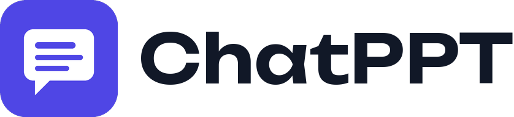

<p align="center">
  
</p>

<p align="center">
  Lean, fast, customisable AI deck tool. Prompt in, editable PPTX out. Bring your own model.
</p>

<p align="center">
  <a href="./LICENSE"></a>
</p>

## Run it

```bash
docker run -p 5000:5000 -v ./chatppt:/data \
  -e CHATPPT_LLM__PROVIDER=openai \
  -e CHATPPT_LLM__PROVIDERS__OPENAI__API_KEY=sk-... \
  ghcr.io/thmen89/chatppt
```

Open <http://localhost:5000>. Everything ChatPPT keeps (decks, settings, templates, prompts)
lives in the `./chatppt` folder.

> **Note:** `ghcr.io/thmen89/chatppt` is TODO(owner): it is published once CI builds and
> pushes the image. Until then, build it yourself with `docker build -t chatppt .` and run the
> upstream-compatible layout: `docker run -p 5000:80 -v ./app_data:/app_data chatppt`.

## What it is

ChatPPT generates presentations from a prompt or your documents, lets you edit them in the
browser, and exports PPTX or PDF. It also has a REST API and an MCP server, so other tools and
agents can make decks.

- **Any model**: OpenAI, Anthropic, Google, Vertex, Azure, Bedrock, Ollama, LM Studio, or any
  OpenAI-compatible endpoint, with a different model per step if you like.
- **Customise by dropping files in `/data`**: templates (`templates/<id>/`), prompt overrides
  (`prompts/<name>.md`), themes (`themes/<id>.json`) and one `chatppt.toml` for settings.
- **Self-hosted**: one container, one data folder, no required external service.

Generate a deck over the API:

```bash
curl -u user:pass -X POST http://localhost:5000/api/v1/ppt/presentation/generate \
  -H "Content-Type: application/json" \
  -d '{"content": "Introduction to machine learning", "n_slides": 5, "export_as": "pptx"}'
```

## Docs

- [`docs/config-reference.md`](docs/config-reference.md): every setting in `chatppt.toml` and its env var.
- [`docs/contracts.md`](docs/contracts.md): the data folder, templates, prompts, providers.
- [`docs/architecture.md`](docs/architecture.md) and [`docs/roadmap.md`](docs/roadmap.md): how it works and where it is going.
- [`docs/amazon-bedrock.md`](docs/amazon-bedrock.md): using Amazon Bedrock.
- [`CONTRIBUTING.md`](CONTRIBUTING.md), [`SECURITY.md`](SECURITY.md), [`CHANGELOG.md`](CHANGELOG.md).

Full user docs are in progress.

## Credits

ChatPPT is derived from [Presenton](https://github.com/presenton/presenton) by the Presenton
team, licensed under Apache-2.0. See [`NOTICE`](NOTICE) and [`docs/upstream.md`](docs/upstream.md).

## License

[Apache-2.0](LICENSE).
